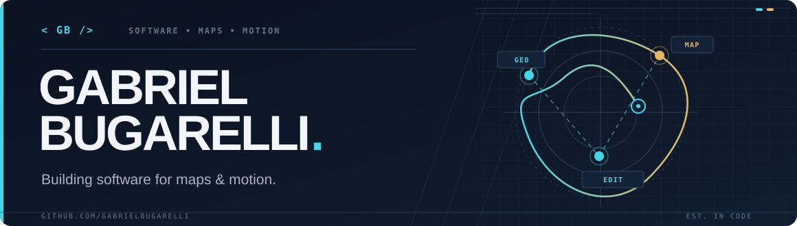

<picture>
  <source media="(prefers-color-scheme: dark)" srcset="./assets/hero-dark.svg" />
  <source media="(prefers-color-scheme: light)" srcset="./assets/hero-light.svg" />
  
</picture>

  <strong>Software developer focused on building useful systems, thoughtful interfaces, and creative tooling.</strong>

  <a href="#selected-work">Selected work</a> ·
  <a href="#engineering-stack">Engineering stack</a> ·
  <a href="https://www.linkedin.com/in/gabrielbugarelli/">LinkedIn</a>

---

### About

I'm Gabriel, a Brazil-based developer working across backend services, web applications, and developer tools. I enjoy turning complex ideas into software with clear architecture and purposeful interfaces.

My interests span API design, full-stack development, and tools that connect engineering with creative workflows.

### Selected work

**[Userman](https://github.com/gabrielbugarelli/userman-project)**  
*Full-stack application · React · TypeScript · NestJS*  
A user-management project with a React interface and a NestJS API using Prisma and SQLite. Includes API documentation through Swagger.

**[FastDelivery API](https://github.com/gabrielbugarelli/fastdelivery-api)**  
*Backend · C# · ASP.NET Core*  
An API design for sales and product management, including role-based permissions for administrators, managers, and sales representatives.

**[Focusy](https://github.com/gabrielbugarelli/focusy)**  
*Frontend · React · TypeScript*  
A productivity timer with session history and local persistence.

### Engineering stack

| Area | Technologies |
| --- | --- |
| Backend & APIs | C#, ASP.NET Core, Node.js, NestJS, Java, Spring |
| Frontend | TypeScript, React, Next.js, Tailwind CSS |
| Data & infrastructure | PostgreSQL, SQLite, Docker, Git |
| Current exploration | Native plugin development, cartographic tools, offline-first workflows |

### Currently building

**[CartoRig](https://github.com/gabrielbugarelli/cartorig)** — exploring offline-first cartographic animation tooling for DaVinci Resolve and native editing workflows. This is an early-stage project; the public repository and its documentation are still being prepared.

---

  <a href="https://www.linkedin.com/in/gabrielbugarelli/">LinkedIn</a> ·
  <a href="https://github.com/gabrielbugarelli?tab=repositories">Repositories</a>

Designed with local SVG assets. No third-party counters, borrowed illustrations, or external image services.

